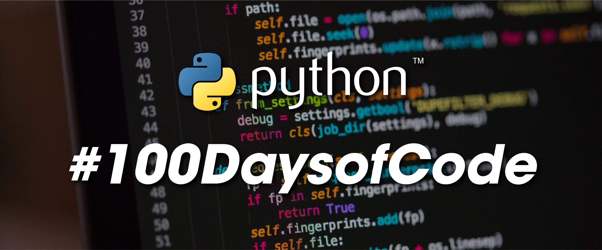

<h1 align="center"> 
#100Daysofcode in Python
</h1>
<h5 align="center">
</h5>

  

    
Day 1 - Day 10

    
##
- <b>Day 1</b> - [Working with Variables in Python to Manage Data](https://github.com/jotavare/100-Days-of-Code-in-Python/tree/main/day-01)

    What i learned:
    - Printing to the Console;
    - String Manipulation and Code Intelligence;
    - Debugging practice;
    - Input function;
    - Python variables and variable naming;

    Exercises:
    - [Print 3 Example Quotes;](https://replit.com/@user/Print-Example-Quotes)
    - [Debugging Practice - Fix the code;](https://replit.com/@user/Fix-the-code)
    - [Print the number of characters in a name;](https://replit.com/@user/Print-Number-of-Characters-in-a-Name)
    - [Write a program that switches variables;](https://replit.com/@user/Switch-Variables)

    Project:
    - [Create a Band Name Generator;](https://replit.com/@user/Band-Name-Generator)
##
- <b>Day 2</b> - [Understanding Data Types and How to Manipulate Strings](https://github.com/jotavare/100-Days-of-Code-in-Python/tree/main/day-02)

    What i learned:
    - Primitive Data Types;
    - Type Error, Type Checking and Type Conversion;
    - Mathematical Operations in Python;
    - Number Manipulation and F Strings in Python;
    - Python variables and variable naming;

    Exercises:
    - [Add the digits in a 2 digit number;](https://replit.com/@user/Sum-Two-Digit-Number)
    - [Body Mass Index (BMI) calculator;](https://replit.com/@user/BMI-Calculator)
    - [Life in weeks calculator (until 90 years old);](https://replit.com/@user/My-Life-in-Days-Weeks-and-Months)

    Project:
    - [Tip Calculator;](https://replit.com/@user/Tip-Calculator)
##
- <b>Day 3</b> - [Control Flow and Logical Operators](https://github.com/jotavare/100-Days-of-Code-in-Python/tree/main/day-03)

    What i learned:
    - Control Flow with if / else and Conditional Operators;
    - Nested if statements and elif statements;
    - Multiple If Statements in Succession;

    Exercises:
    - [Odd and Even Number Checker;](https://replit.com/@user/Odd-and-Even-Number-Check)
    - [BMI Calculator with Interpretation;](https://replit.com/@user/BMI-Calculator-Interpretation)
    - [Leap Year Checker;](https://replit.com/@user/Leap-Year-Check)
    - [Automatic Pizza Order Program;](https://replit.com/@user/Automatic-Pizza-Order-Program)
    - [Love Calculator;](https://replit.com/@user/Love-Calculator)

    Project:
    - [Treasure Island game;](https://replit.com/@user/Treasure-Island-Game)
##
- <b>Day 4</b> - [Randomisation and Python Lists](https://github.com/jotavare/100-Days-of-Code-in-Python/tree/main/day-04)

    What i learned:
    - Random Modules;
    - Understanding the Offset and Appending Items to Lists;
    - IndexErrors and Working with Nested Lists;

    Exercises:
    - [Virtual Coin Toss - Heads or Tails;](https://replit.com/@user/Virtual-Coin-Toss-Program-Heads-or-Tails)
    - [Banker Rouletter - Who pays the bill;](https://replit.com/@user/Bank-Rouletter-Who-pays-the-bill)
    - [Treasure Map;](https://replit.com/@user/Treasure-Map-Mark-with-X)
    
    Project:
    - [Rock, Paper, Scissors;](https://replit.com/@user/Rock-Paper-Scissors)
##
- <b>Day 5</b> - [Python Loops](https://github.com/jotavare/100-Days-of-Code-in-Python/tree/main/day-05)

    What i learned:
    - Using the for loop with Python Lists;
    - 'for' loops and the range() function;

    Exercises:
    - [Average Height Calculator;](https://replit.com/@user/Average-Height-Calculator)
    - [Highest Student Score;](https://replit.com/@user/Highest-Student-Score)
    - [Adding Even Numbers;](https://replit.com/@user/Sum-of-All-Even-Numbers-1-100)
    - [The FizzBuzz Challenge;](https://replit.com/@user/Solution-to-FizzBuzz-Game)

    Project:
    - [Create a Password Generator;](https://replit.com/@user/Password-Generator)
##
- <b>Day 6</b> - [Python Functions & Karel](https://github.com/jotavare/100-Days-of-Code-in-Python/tree/main/day-06)

    What I learned:
    - Defining and Calling Python Functions;
    - Indentation in Python;
    - While Loops;

    Challenges:
    - [Reeborgs Wolrd Challenge 1;](https://lnkd.in/gMVk8VDA)
    - [Reeborgs Wolrd Challenge 2;](https://lnkd.in/ggaN6aVb)
    - [Reeborgs Wolrd Challenge 3;](https://lnkd.in/gJ5uVR3q)
    - [Reeborgs Wolrd Challenge 4;](https://lnkd.in/g4Y3ED3H)
    - [Reeborgs Wolrd Challenge 5;](https://lnkd.in/gJY5jB8h)
    
    Final Challenge:
    - [Reeborgs Wolrd Challenge Maze;](https://lnkd.in/gf6sSEPM)
##
- <b>Day 7</b> - [Hangman](https://github.com/jotavare/100-Days-of-Code-in-Python/tree/main/day-07)

    What I learned:
    - How to break a Complex Problem down into a Flow Chart;

    Exercises:
    - [Picking a Random Word and Checking Answers;](https://replit.com/@user/Unfinished-Hangman-Stage-1)
    - [Replacing Blanks with Guesses;](https://replit.com/@user/Unfinished-Hangman-Stage-2)
    - [Checking if the Player has Won;](https://replit.com/@user/Unfinished-Hangman-Stage-3)
    - [Keeping Track of the Player's Lives;](https://replit.com/@user/Unfinished-Hangman-Stage-4)

    Project:
    - [Hangman Game - Final Stage;](https://replit.com/@user/Finished-Hangman-Final-Stage)
##
- <b>Day 8</b> - [Function Parameters & Caesar Cipher](https://github.com/jotavare/100-Days-of-Code-in-Python/tree/main/day-08)

    What I learned:
    - Functions with Inputs;
    - Positional vs. Keyword Arguments;

    Exercises:
    - [Paint Area Calculator;](https://replit.com/@user/Paint-Area-Calculator)
    - [Prime Number Checker;](https://replit.com/@user/Prime-Number-Checker)

    Project:
    - [Caesar Cipher (Encrypt and decrypt messages);](https://replit.com/@user/Caesar-Cipher-EncryptDecrypt)
##
- <b>Day 9</b> - [Beginner - Dictionaries, Nesting and the Secret Auction](https://github.com/jotavare/100-Days-of-Code-in-Python/tree/main/day-09)

    What I learned:
    - The Python Dictionary: Deep Dive; 
    - Nesting Lists and Dictionaries; 

    Exercises:
    - [Grading Program;](https://replit.com/@user/Grading-Program)
    - [Dictionary in List;](https://replit.com/@user/Dictionary-in-List)

    Project:
    - [Blind Auction;](https://replit.com/@user/Blind-Auction)
##
- <b>Day 10</b> - [Functions with Outputs](https://github.com/jotavare/100-Days-of-Code-in-Python/tree/main/day-10)

    What I learned:
    - Functions with Outputs;
    - Multiple return values;
    - Docstrings;
    - Combining Dictionaries and Functions;
    - Print vs. Return;
    - While Loops, Flags and Recursion;

    Exercises:
    - [Upper Case First Letter;](https://replit.com/@user/Upper-Case-First-Letter)
    - [Days in Month;](https://replit.com/@user/Days-in-Month)

    Project:
    - [Calculator;](https://replit.com/@user/Calculator)
##

    
Day 11 - Day 20

##
- <b>Day 11</b> - [The Blackjack Capstone Project](https://github.com/jotavare/100-Days-of-Code-in-Python/tree/main/day-11)

    Capstone Project:
    - [Blackjack;](https://replit.com/@user/Blackjack)
##
- <b>Day 12</b> - [Scope & Number Guessing Game](https://github.com/jotavare/100-Days-of-Code-in-Python/tree/main/day-12)

    What I learned:
    - Namespaces: Local vs. Global Scope;
    - Does Python Have Block Scope?;
    - How to Modify a Global Variable;
    - Python Constants and Global Scope;

    Project:
    - [Guess the Number;](https://replit.com/@user/Guess-the-Number)
##
- <b>Day 13</b> - [Debugging: How to Find and Fix Errors in your Code](https://github.com/jotavare/100-Days-of-Code-in-Python/tree/main/day-13)

    What I learned:
    - Describe the Problem;
    - Reproduce the Bug;
    - Play Computer and Evaluate Each Line;
    - Fix Errors and Watch for Red Underlines;
    - Squash bugs with a print() Statement;
    - Use a Debugger;

    Debugging Old Projects:
    - [Debugging Odd or Even](https://replit.com/@user/Debugging-Odd-or-Even)
    - [Debugging Leap Year](https://replit.com/@user/Debuggin-Leap-Year)
    - [Debugging FizzBuzz](https://replit.com/@user/Debugging-FizzBuzz)

    Tools user for Debugging:
    - [Python Tutor](https://pythontutor.com/)
    - [Thonny](https://thonny.org/)
##
- <b>Day 14</b> - [Higher Lower Game Project](https://github.com/jotavare/100-Days-of-Code-in-Python/tree/main/day-14)

    Project:
    - [Higher Lower Game](https://replit.com/@user/Higher-or-Lower-Game)
##
- <b>Day 15</b> - [Local Development Environment Setup & the Coffee Machine](https://github.com/jotavare/100-Days-of-Code-in-Python/tree/main/day-15)

    What I learned:
    - Download and install Python Locally;
    - Download and install PyCharm for Windows:
    - PyCharm's Features;
  
    Project:
    - [Coffee Machine](https://replit.com/@user/Coffee-Machine)
##

